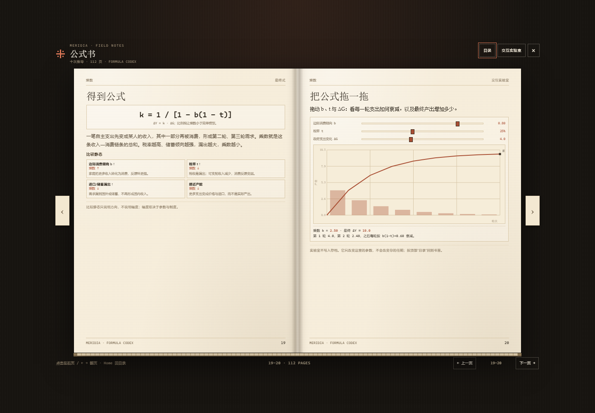
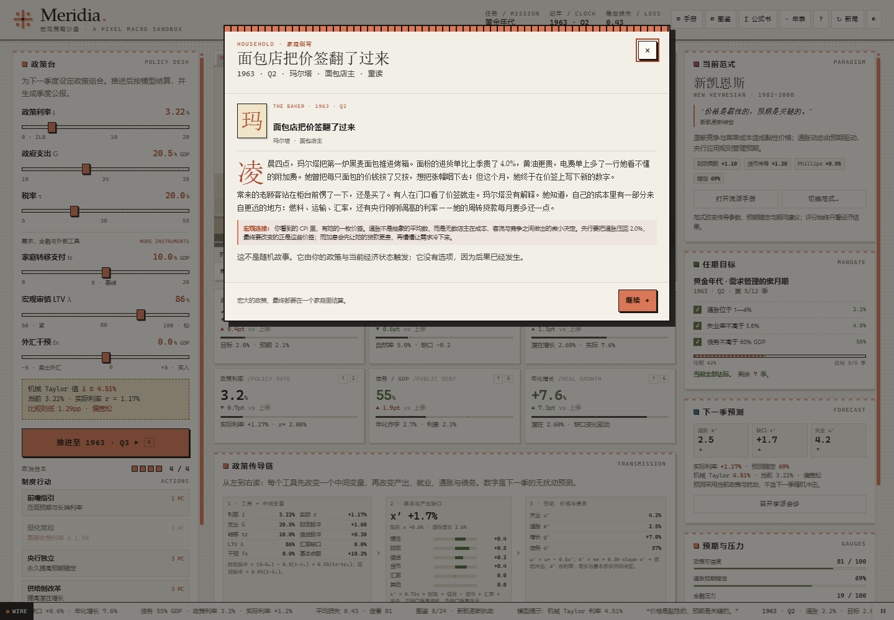

# Meridia.

> 把曼昆与凯恩斯装进一座像素城市。

**Meridia** 是一个单文件、离线可玩的宏观经济学策略沙盘。你接手一个虚构经济体，在通胀、失业、产出缺口、债务与政策信誉之间做取舍。每个季度，你设定六种政策工具、执行制度行动；模型把结果写回仪表盘、像素城市与历史曲线。你还可以翻开两本超过一百页的书：一本从历史条件、人物与争论讲清八个流派，一本把十个核心公式从符号、假设、中间推导一直讲到可拖动的实验、案例与边界。

[**在线试玩**](https://promax-mafker.github.io/meridia/) · [单文件版本](meridia.html) · [知识框架](#知识框架) · [模型说明](#模型)


---

## 为什么做这个

宏观经济学很容易被拆成两件事：一边是教科书里的方程，另一边是新闻里的争论。

Meridia 想做的，是把两者放回同一个决策现场：你会在 1979 年面对通胀预期脱锚，在 2008 年发现利率已经降到零，在 2022 年同时承受供给冲击与高债务。你可以选择凯恩斯、货币主义、新凯恩斯、MMT 或奥地利学派的视角；范式会真实改变财政乘数、Phillips 斜率与预期锚定，而不只是换一段引言。

没有唯一解。Taylor 规则只是一个机械参考，历史也没有标准答案。

### 第二版新增

- **流派手册 50 → 106 页**：每个流派 11 页，补上历史条件、思想语境、概念建筑、因果机制、形式模型、内部争论、政策证据与研讨问题。
- **公式书 22 → 112 页**：每个公式 10 页，拆开中间公式并解释其经济学含义；新增可直接拖动的图与读数。
- **六种政策工具**：政策利率、政府支出、税率、家庭转移支付、按揭 LTV 上限、外汇干预。
- **政策传导链**：把“工具 → 中间变量 → 需求 → 就业/通胀/债务”逐段展开，并链接到公式书。
- **指标小词典**：19 个指标的解释、常见区间与读法；所有 KPI 卡片都有 `?` 入口。
- **家庭侧写**：12 个无选项事件，从普通人或家庭视角写政策落地后的生活，并给出宏观连接。

---

## 它能做什么

| 模块 | 内容 |
|---|---|
| **6 个情境（含沙盒）** | 1962 黄金年代、1979 大通胀、2008 零利率下限、2022 供给冲击、2013 长期停滞、2026 自由推演 |
| **8 大学派范式** | 古典、凯恩斯、货币主义、新古典宏观、新凯恩斯、后凯恩斯、MMT、奥地利 |
| **流派手册（H）** | 106 页，8 章 × 11 页：历史条件、思想语境、核心问题、概念建筑、因果机制、形式模型、人物、争论、证据、边界与研讨 |
| **公式书（F）** | 112 页，10 章 × 10 页：故事、符号、假设、三段推导、中间式经济含义、可拖动实验室、案例、证据与练习 |
| **指标小词典** | 19 个指标；手册前置 10 页“指标入门”；每张 KPI 卡片有 `?` 入口 |
| **6 种政策工具** | 政策利率 i、政府支出 G、税率 τ、家庭转移 tr、按揭 LTV λ、外汇干预 fx |
| **家庭侧写** | 12 个无选项事件：普通人/家庭视角 + 宏观连接；不改变分数 |
| **政策传导链** | 工具 → 实际利率/财政/信贷/汇率 → 产出缺口 → 失业、通胀、债务；每项带数字与公式链接 |
| **24 个知识词条** | 附学派关系图、关键词搜索、逐条解锁与“研习模式” |
| **28 个年表节点** | 1776—2023：著作、危机、政策实验与范式转移 |
| **实时方程** | 当前存档的 Fisher、Taylor、Okun、Phillips、财政脉冲、债务动态、部门余额、r* 缺口、增长与缺口、Solow |
| **4 个交互实验室（L）** | 乘数、Taylor 规则、债务雪球、IS–LM |
| **17 个抉择事件** | 石油危机、金融恐慌、债券义警、工资—价格螺旋、供应链断裂、疫情、货币危机…… |
| **7 个制度行动** | 前瞻指引、量化宽松、央行独立、供给侧改革、银行纾困、收入政策、家庭转移支付 |
| **完整任期循环** | 6 个政策杠杆、政治资本、季度公报、损失函数、S/A/B/C/D 评级、继续执政 |

---

## 快速开始

### 在线玩

打开 **[promax-mafker.github.io/meridia](https://promax-mafker.github.io/meridia/)**。

### 本地玩

```bash
git clone https://github.com/promax-mafker/meridia.git
cd meridia
# 直接双击 index.html 或 meridia.html
```

如果浏览器禁止本地文件写入 `localStorage`，用本地服务器打开：

```bash
python -m http.server 8000
# 打开 http://localhost:8000/
```

不需要安装依赖，不需要构建。

---

## 怎么玩

1. **选择情境与初始范式。** 不同范式的传导参数不同，难度也不同。
2. **设定下一季度的政策组合**：政策利率 `i`、政府支出 `G`、税率 `τ`、家庭转移 `tr`、按揭 LTV `λ`、外汇干预 `fx`。
3. **先看“政策传导链”**：它会告诉你每个工具先改变哪个中间变量，以及这些变化如何进入产出、就业、通胀与债务。
4. **用政治资本执行制度行动。** 行动不消耗回合，但有成本和冷却时间。
5. **推进一个季度。** 随机或脚本事件会先要求你做出选择；结算后，家庭侧写可能自动出现。
6. **守住任期目标**：通胀、失业、债务，以及你选择的路线。
7. **查看述职报告。** 评级基于后半程目标命中率、期末达标与损失预算内的稳定表现；可以继续执政 8 季。

> 第一次玩？先读手册第 1—18 页的“如何读”和“指标入门”，或点击任意 KPI 右上角的 `?`。不需要先学完理论。

### 快捷键

| 按键 | 动作 |
|---|---|
| `N` | 推进一个季度 |
| `H` | 打开流派手册 |
| `K` | 打开知识图鉴 |
| `T` | 打开学说年表 |
| `F` | 打开公式书 |
| `L` | 打开交互实验室 |
| `?` | 打开帮助 |
| `Esc` | 关闭弹窗 |

在书里：`←` / `→` 翻页，`Home` 回到目录。

移动端会纵向堆叠：政策台、城市与指标、图表、公报、范式面板。

---

## 情境

| 情境 | 年份 | 核心问题 |
|---|---|---|
| 黄金年代 | 1962 | 需求管理的蜜月期，小冲击下维持充分就业 |
| 大通胀 | 1979 | 用多深的衰退换回价格稳定？信誉如何重建？ |
| 零利率下限 | 2008 | 利率触底后，财政、QE 与前瞻指引谁来接棒？ |
| 供给冲击 | 2022 | 高通胀 + 高债务，软着陆还是硬着陆？ |
| 长期停滞 | 2013 | 负自然利率、低通胀与弱复苏 |
| 自由推演 | 2026 | 无剧本沙盒，自定义成功 |

---

## 知识框架

Meridia 的知识层不是旁注，而是模型的一部分。

### 主线

```text
古典 → 凯恩斯 → 新古典综合 → 货币主义 → 新古典宏观 → 新凯恩斯 → HANK
```

### 批判与替代

```text
后凯恩斯 · MMT · 奥地利 · 行为宏观 · 长期停滞 · 零利率下限
```

**流派手册（H）** 是一本摊开的书，106 页。目录由八张用抽象符号绘制的图版组成，点击即进入对应章节。每章固定十一页：历史条件 I/II、核心问题、概念建筑、因果机制、形式模型、人物与思想、争论与关系、证据与政策、边界与研讨；章首还有本章目录。历史页会给出具体年份、物质条件与“历史现场”侧写，而不只是抽象的学派标签。

**公式书（F）** 独立成书，112 页。十组核心公式各十页：故事与问题、符号与假设、推导 I/II/III、最终式与比较静态、可拖动实验室、数值案例、证据、误区与练习。每个中间公式后面都有“这意味着什么”，把代数步骤翻译回经济学。覆盖乘数、IS–LM、Phillips、Okun、Fisher、Taylor、债务动态、货币数量论、Solow 与部门余额。

**指标小词典** 收录 19 个指标，解释它衡量什么、为什么重要、怎么读、常见区间与驱动因素。主界面的每张 KPI 卡片右上角都有 `?`；手册前置的 10 页“指标入门”提供更完整的语境。

**图鉴（K）** 收录 24 个词条，每个词条包含：核心命题、数理表达、政策含义、批评与边界、它在沙盘中的具体体现，以及关联词条。图鉴会随任期解锁；“研习模式”可以随时解锁全部内容。

**年表（T）** 从 1776 年《国富论》延伸到 2023 年的 AI 与生产率争论，把著作、危机与政策实验放在同一条时间线上。

**交互实验室（L）** 保留原来的实时方程与四个可拖动的实验；公式书里另有十个内嵌实验，学习公式时可以直接拖动参数看曲线变化。

**家庭侧写** 是一种“无选项事件”：不要求你选择，只从一个普通人或家庭的角度描述你的政策落地后的生活。它由当前状态触发，文中数字来自模型，末尾的“宏观连接”解释因果。

<p align="center">
  
  
</p>

<p align="center">
  
</p>

---

## 模型

Meridia 是一个季度频率、线性化、半结构的教学模型。核心状态包括产出缺口、通胀、通胀预期、失业、债务、金融压力、政策信誉与自然利率。

```text
x′  = 0.72x + 0.30·fiscal·mult + credit − 0.45·mon·(r − r*) + 0.12·fx + shock
fiscal = (G − G₀) − 0.5(τ − τ₀) + 0.55(tr − tr₀)
credit = 0.05(λ − λ₀)
π′  = πe + 0.30·slope·x′ + 0.06·fx + supply
πe′ = a·π* + (1 − a)·π′       a = credibility × anchoring
u′  = u* − 0.5x′
g   = g* + 4(x′ − x)
fx′ = 0.72·fx − 0.10(i − i_foreign) + 0.35·fx_op + shock
d′  = d + [(i − π − g)d/100 + primary]/4
primary = G + tr − tax
```

- **财政脉冲** = `(G − G₀) − 0.5(τ − τ₀) + 0.55(tr − tr₀)`
- **信贷脉冲** = `0.05(λ − λ₀)`；高 LTV 也推高金融压力
- **实际利率** = `i − πe`
- **外汇干预**：正数为净买入外汇，压低本币、推高进口通胀并积累储备；负数为卖出外汇
- **政策可信度**会因偏离目标、金融压力与政策方向而变化；信誉越低，预期越接近实际通胀，牺牲率越高。
- **自然失业率**会因长期高失业缓慢漂移（滞后效应）。

范式的 `mult`、`mon`、`slope`、`anchoring` 是刻意设置的“理论滤镜”，用于比较不同理论下的政策结果，不代表经验估计。

### 边界

这是一个教学模拟，不是预测工具，也不是政策建议。它没有显式微观基础、银行资产负债表、完整的开放经济资本流动或资产价格；它无法替代 DSGE、实证估计或历史研究。

---

## 技术

- **单文件**：`meridia.html` 内联全部 HTML、CSS 与 JavaScript，约 520 KB。
- **零依赖**：无 CDN、无外部字体、无构建步骤、无第三方库。
- **原生 Canvas**：像素城市、事件插画、时间序列图、实验室曲线与公式书内嵌图。
- **真实翻页**：两本书都是 CSS 3D 书页，带书脊、纸纹、页面阴影与枢机旋转；移动端切换为单页。
- **响应式**：桌面三栏、平板单栏、移动端纵向布局。
- **可访问性**：键盘操作、焦点陷阱、`inert` 背景、ARIA 标签、`prefers-reduced-motion`、可见焦点样式。
- **本地存档**：`localStorage` 自动保存当前任期、图鉴进度与偏好；可随时开新局或清除存档。
- **明暗主题**：纸张色 / 墨色两套 Claude 风格调色板。

> 在 Microsoft Edge 中完成主要测试；建议使用较新的 Chrome / Edge / Firefox / Safari。

### 目录

```text
.
├── index.html            # GitHub Pages 入口（与 meridia.html 内容相同）
├── meridia.html          # 单文件游戏，可直接下载
├── docs/
│   ├── preview.png       # 主界面截图
│   ├── handbook.png      # 流派手册跨页
│   ├── formula.png       # 公式书实验室跨页
│   └── household.png     # 家庭侧写
├── LICENSE               # MIT
├── README.md
└── .nojekyll             # GitHub Pages：跳过 Jekyll
```

---

## 来源与延伸

知识框架以 **N. Gregory Mankiw, _Macroeconomics_** 与 **John Maynard Keynes, _The General Theory of Employment, Interest and Money_ (1936)** 为骨架，并扩展了：

- Milton Friedman, “The Role of Monetary Policy” (1968); Friedman & Schwartz, _A Monetary History of the United States_ (1963)
- Edmund Phelps (1967–68); Robert Lucas (1972, 1976); Kydland & Prescott (1977, 1982)
- John Taylor (1993); 新西兰通胀目标制（1990）
- Hyman Minsky (1986); Randall Wray / MMT 传统
- Lawrence Summers (2013) 的长期停滞；Kaplan & Moll (2018)、Auclert (2019) 等 HANK 文献

所有中文表述都经过压缩与改写，适合建立框架，不替代原典。手册中的人物小传只保留与思想相关的生平与代表作，不追求完整传记。

---

## 许可

[MIT](LICENSE) © 2026 promax-mafker

## 致谢与声明

视觉语言借鉴了 Claude / Anthropic 的纸张色、衬线标题与克制排版，但本项目与 Anthropic 无隶属关系。`Meridia` 是虚构经济体，所有数据与政策结果均为教学模拟；不构成投资、预测或政策建议。
